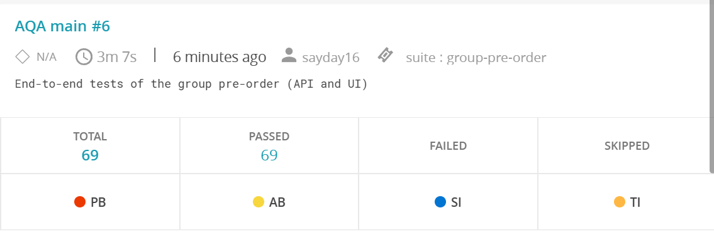

# Restaurant AQA: end-to-end тести групового pre-order

Автоматизація Test Automation HW #8 для власної реалізації застосунку Green & Tasty (Backend на AWS Lambda + Angular на CloudFront).

## Обраний напрям і підхід

- **Напрям 1: груповий pre-order**, усі три рівні (перегляд учасників, підтвердження, видалення учасника) плюс наскрізний сценарій. Backend і Frontend власні, інтегровані й розгорнуті, тому тестується саме це середовище.
- **Піраміда тестів:** UI-тести основних сценаріїв (Playwright) і API-тести авторизації, валідації та граничних випадків (HttpClient). Підготовка даних (гості, кошики) виконується через API.
- **Стек:** C# (.NET 10), NUnit, Playwright for .NET.
- **Архітектура: Page Object + API-клієнти, без BDD.** Обґрунтування: сценарії короткі й перевіряють правила та коди відповідей, для яких таблиця тестів у NUnit читається так само добре, як Gherkin, без шару step-definitions. Page Object ховають локатори екрана, а типізований API-клієнт ховає ендпоінти й тіла запитів, тож тести описують поведінку, а не мережу чи DOM. Локатори: роль і доступне ім'я, label, placeholder, текст (CSS лише там, де інакше неможливо, з коментарем).

## Що саме тестується

| Рівень | Функція | Ендпоінти / екран |
|---|---|---|
| L1 | Перегляд учасників групи Owner-ом | `GET /guest/groups/{id}/sessions`, екран `/reservations/{id}/group-order` |
| L2 | Власна сесія Owner-а і підтвердження консолідованого pre-order | `GET /reservations/{id}/guest-session-id`, `POST /group-reservations/{id}/submit` |
| L3 | Видалення учасника | `DELETE /guest/groups/{id}/sessions/{guestSessionId}` |

Покриття (позитивні й негативні сценарії):

- **L1:** учасники з стравами, кількостями й сумами; загальна сума = сума по учасниках і змінюється при зміні кошика; непідтверджений учасник і учасник без страв у списку; група без гостей; список бачить лише Owner (інший клієнт 403, гість 401, неавторизований 401, офіціант 403, неіснуюча група 404). UI: екран показує учасників, статуси, суми, консолідований блок, плашку про непідтверджених, оновлення без перезавантаження, відмова чужому клієнту й неавторизованому.
- **L2:** власна сесія стабільна й з'являється як `Owner`; підтвердження об'єднує однакові страви, ігнорує непідтверджені кошики, змінює статус order на `SubmittedByCustomer` і групи на `Submitted`; офіціант бачить order; відмови: немає підтверджених кошиків, немає order, немає групи, немає бронювання, чужа група для бронювання (400), не-Owner (403/401), повторний submit (400), валідація тіла (порожнє, без `reservationId`, зламаний JSON). UI: підтвердження через діалог, екран стає read-only, скасування діалогу нічого не відправляє, кнопка неактивна без підтверджених кошиків, офіціант бачить склад в інтерфейсі.
- **L3:** видалення одного з кількох (решта лишається, сума перерахована), видалення учасника з підтвердженим кошиком, видалення останнього, учасник іншої групи (400, обидві групи без змін), неіснуючий учасник/група (404), повторне видалення (404), не-Owner (403/401), видалений гість втрачає доступ (401), видалений не впливає на submit. UI: видалення через діалог з оновленням списку й сум, скасування діалогу. Наскрізний сценарій: гості додають страви, Owner переглядає, видаляє одного, підтверджує, офіціант бачить order без видаленого.
- **Auth (UI):** вхід через справжню форму і відхилення невірного пароля.

## Структура

```
src/RestaurantAqa/
  Config/        TestSettings: змінні середовища та .env
  Api/           ApiClient (HttpClient), RestaurantApi (ендпоінти), Dtos
  Data/          UserFactory, CatalogResolver, SlotAllocator, GroupScenario (дані + прибирання)
  Ui/            UiTestBase (браузер, trace/скриншот/відео), UiAuth, Pages/ (Page Object)
  Tests/Api/     SmokeTests, GroupSessionsTests (L1), SubmitGroupTests (L2), RemoveParticipantTests (L3)
  Tests/Ui/      GroupOrderUiTests, LoginAndWaiterUiTests
.github/workflows/aqa.yml   пайплайн
```

## Налаштування

Потрібні .NET SDK 10 і Chrome (або Chromium від Playwright).

1. Скопіюйте `.env.example` у `.env` і заповніть **власними** значеннями. `.env` у `.gitignore`, комітити його не можна:

   | Змінна | Обов'язкова | Призначення |
   |---|---|---|
   | `API_BASE_URL` | так | адреса stage API Gateway вашого backend |
   | `UI_BASE_URL` | для UI-тестів | адреса вашого фронтенду (CloudFront) |
   | `WAITER_EMAIL`, `WAITER_PASSWORD` | ні | існуючий офіціант локації; без них тести з тегом `Waiter` пропускаються |
   | `TABLE_ID` | ні | стіл для бронювання; без нього береться перший стіл на 6 гостей |
   | `BROWSER_CHANNEL` | ні | `chrome` або `msedge` для встановленого браузера; порожньо означає Chromium Playwright |
   | `HEADED=1` | ні | показувати браузер |
   | `RECORD_VIDEO=1` | ні | відео впалих UI-тестів (потрібен ffmpeg Playwright, у CI вмикається) |
   | `ARTIFACTS_DIR` | ні | куди писати trace/скриншоти/відео (за замовчуванням `./artifacts`) |

2. Для середовища потрібні щонайменше три доступні страви з різними цінами й стіл на 6+ гостей. Офіціант створюється у вашому середовищі (через реєстрацію офіціантом стати не можна).
3. Якщо не використовуєте встановлений Chrome, один раз встановіть браузер Playwright:
   ```bash
   dotnet build
   pwsh src/RestaurantAqa/bin/Debug/net10.0/playwright.ps1 install chromium
   ```

## Запуск

```bash
dotnet test                                        # усе
dotnet test --filter "Category=Smoke"              # швидка перевірка середовища (без акаунтів і даних)
dotnet test --filter "Category=API"                # лише API
dotnet test --filter "Category=UI"                 # лише UI
dotnet test --filter "Category=L1"                 # один рівень: L1, L2 або L3
dotnet test --filter "Category=E2E"                # наскрізний сценарій
dotnet test --filter "Category!=Slow"              # без тестів, що чекають на фонову синхронізацію (~15 с)
dotnet test --filter "Category=Waiter"             # лише сценарії офіціанта
dotnet test --filter "FullyQualifiedName~SubmitGroupTests"   # один клас
```

Теги: `API`, `UI`, `Smoke`, `L1`, `L2`, `L3`, `E2E`, `Waiter`, `Auth`, `Slow`.

Приклад запуску без `.env`:

```bash
API_BASE_URL=https://<id>.execute-api.<region>.amazonaws.com/develop \
UI_BASE_URL=https://<id>.cloudfront.net BROWSER_CHANNEL=chrome dotnet test --filter "Category=UI"
```

## Тестові дані та незалежність тестів

- Кожен тест сам створює потрібне: **нового клієнта** (унікальний email `aqa-<guid>@example.com`), **бронювання** на випадкову дату за 3-60 днів уперед в одному з шести двогодинних слотів (колізія з іншим бронюванням повторюється з іншим слотом), order і гостей через публічний API. Порядок виконання не важливий, фікстури запускаються паралельно (4 потоки).
- Дані, що залежать від часу (початок бронювання, дата в UI), обчислюються від поточного моменту (`now + N`).
- **Прибирання:** після кожного тесту `GroupScenario` скасовує order і бронювання (це закриває групу). Облікові записи клієнтів API видалити не дозволяє, тому вони лишаються з префіксом `aqa-`, їх легко відфільтрувати. Тестова група, гостьові сесії й скасоване бронювання лишаються в базі як неактивні дані.
- Браузер працює у стабільних `Locale=en-US` і `TimezoneId=UTC`, тому дати й часи однакові на ноутбуку та в CI.

## Звіти та матеріали для розбору

- Консоль, TRX і HTML-звіт: `dotnet test --logger "trx;LogFileName=results.trx" --logger "html;LogFileName=report.html"` (папка `TestResults/`). У CI це робиться автоматично.
- Для кожного **впалого UI-тесту** зберігаються у `artifacts/ui/<ім'я тесту>/`: `failure.png` (скриншот), `trace.zip` (Playwright trace: відкривається командою `pwsh bin/Debug/net10.0/playwright.ps1 show-trace trace.zip` або на https://trace.playwright.dev) і `video.webm` (при `RECORD_VIDEO=1`). Файли додаються до результату тесту.
- Для впалих API-тестів у повідомленні про помилку є метод, шлях, код і тіло відповіді.

## Report Portal (завдання з зірочкою)

Адаптер `ReportPortal.NUnit` підключений і за замовчуванням **вимкнений** (`src/RestaurantAqa/ReportPortal.config.json`, `"enabled": false`).

1. Підніміть Report Portal локально в Docker (офіційний compose):
   ```bash
   curl -LO https://raw.githubusercontent.com/reportportal/reportportal/master/docker-compose.yml
   docker compose -p reportportal up -d
   ```
   Інтерфейс на `http://localhost:8080`. Змініть паролі за замовчуванням, створіть проєкт і скопіюйте **API key** з профілю користувача.
2. Увімкніть адаптер змінними середовища (або в `.env`):
   ```bash
   export ReportPortal_Enabled=true
   export ReportPortal_Server_Url=http://localhost:8080
   export ReportPortal_Server_Project=default_personal
   export ReportPortal_Server_Authentication_Uuid=<API key>
   dotnet test
   ```
   Запуск з'явиться в розділі Launches проєкту, із результатами кожного тесту й вкладеннями.
3. У CI Report Portal потрібно розмістити там, куди дістанеться runner (хмарний сервер із публічною адресою), і задати змінні репозиторію `REPORTPORTAL_ENABLED=true`, `REPORTPORTAL_URL`, `REPORTPORTAL_PROJECT` та секрет `REPORTPORTAL_API_KEY`. Без них крок просто пропускається.

**Результат у хмарі.** Пайплайн у GitHub Actions надсилає звіт у demo.reportportal.io (проєкт `sayday16_personal`). Запуск «AQA main #6» (69 із 69 тестів пройшли, suite `group-pre-order`, 3 хв 7 с):



Демо-портал стирає дані раз на добу, тому знімок збережено в репозиторії; новий звіт з'являється після кожного запуску пайплайна.

## CI pipeline (хмара)

Пайплайн `.github/workflows/aqa.yml` виконується в GitHub Actions (хмарний runner). Запуск: push у `main`, pull request, щоночі о 05:00 UTC і вручну (`workflow_dispatch` з необов'язковим NUnit-фільтром, наприклад `Category=L2`).

Налаштуйте репозиторій: **Settings > Secrets and variables > Actions**

| Тип | Ім'я | Призначення |
|---|---|---|
| Variable | `API_BASE_URL`, `UI_BASE_URL` | адреси вашого розгорнутого застосунку (обов'язково) |
| Variable | `TABLE_ID` | необов'язково |
| Secret | `WAITER_EMAIL`, `WAITER_PASSWORD` | необов'язково, для сценаріїв офіціанта |
| Variable / Secret | `REPORTPORTAL_ENABLED`, `REPORTPORTAL_URL`, `REPORTPORTAL_PROJECT` / `REPORTPORTAL_API_KEY` | необов'язково |

Кроки: збірка, встановлення Chromium, запуск тестів, підсумок у Summary, завантаження артефактів (`test-reports`: TRX і HTML; `ui-failure-artifacts`: trace, скриншоти, відео). **Впалий тест не зупиняє пайплайн:** звіти й артефакти публікуються завжди, а job позначається проваленим наприкінці.

## Обрана поведінка для випадків, не визначених у ДЗ

| Ситуація | Очікування в тестах |
|---|---|
| Інший клієнт (не Owner) | 403 |
| Гість (його токен сесії) або без авторизації | 401 (відмовляє authorizer API Gateway) |
| Офіціант | 403 (Owner це клієнт, який створив бронювання) |
| Повторний submit | 400 з `errorCode = GroupReservationSubmitted`, order не змінюється |
| Група без учасників | `participants: []`, `total: 0` |
| Видалення останнього учасника | 200, `participants: []`, `total: 0` |
| Повторне видалення того самого учасника | 404 |
| Бронювання з іншої групи в тілі submit | 400 |
| Гість приєднується до підтвердженої групи | 400 з `GroupReservationSubmitted` |
| Видалений гість працює зі своєю сесією | 401 |

## Обмеження й особливості

- **Сесія Owner-а створюється при першому запиті** `guest-session-id` (екран Owner робить його сам), тому в «групі без учасників» без цього запиту список порожній.
- **Знайдено тестами: дефект екрана Owner.** Екран читав список учасників паралельно зі створенням Owner-сесії, тому при першому завантаженні могла бути відсутня картка «My Pre-Order». Виправлено у frontend (версія 1.1.2): спершу запитується Owner-сесія, потім список.
- **Список учасників читається з вторинного індексу DynamoDB** (eventual consistency): відповідь на `DELETE` одразу після видалення може ще містити видаленого гостя. Тести видалення очікують оновлення індексу (до 10 с) і лише потім перевіряють результат.
- **Owner не може додати страви у власну сесію групи:** власні страви Owner-а лежать у його pre-order (order бронювання), а не в гостьовій сесії. Тест перевіряє, що вони потрапляють у підсумковий order разом із груповими.
- **Умова «підтверджені кошики без жодної страви → 400»** недосяжна через публічний API (гість не може підтвердити порожній кошик, перевірено тестом `A_guest_can_not_confirm_an_empty_cart...`), вона покрита unit-тестами backend.
- Після submit група має статус `Submitted`, і запрошення для неї більше не видається; екран Owner для такої групи після перезавантаження показує помилку завантаження.
- Облікові записи тестових клієнтів не видаляються (немає API).
- Сценарії офіціанта виконуються, лише якщо задано `WAITER_EMAIL` і `WAITER_PASSWORD`. Це має бути **справжній офіціант**: акаунт, зареєстрований через сайт, є клієнтом. Додати існуючий акаунт у список офіціантів локації можна запитом `POST /waiters` з `email` і `locationId`; без цього тест одразу скаже, що акаунт має роль `Customer`.
- **Тестове середовище має обмеження AWS навчального акаунту**, які впливали на стабільність: Lambda на 128 МБ відповідала довше за 29 с (504), а таблиці DynamoDB з 1 одиницею читання/запису тротлились (`ProvisionedThroughputExceededException`). Для стабільного прогону Lambda `api-handler` має 1024 МБ, а таблиці переведені в режим `PAY_PER_REQUEST`.
- Через це клієнт тестів повторює читання (GET) після тимчасової відповіді 5xx, створення бронювання повторюється в іншому слоті, а реєстрація, якщо не вдалась, пробується з новим email. Записи, які можуть змінити стан, автоматично не повторюються.
- Бронювання не можна видалити через API, тому тести скасовують їх після виконання, а слоти беруться з випадкового дня в діапазоні 3-400 днів уперед.
- Знайдені тестами дефекти застосунку: екран Owner міг при першому завантаженні не показати власну картку; пропонований вільний слот міг відхилятись при створенні, бо правила слотів і створення бронювання відрізнялись (виправлено в застосунку).
- **Report Portal.** Звіти надсилаються в demo.reportportal.io (проєкт `sayday16_personal`) у CI, коли задано змінну `REPORTPORTAL_ENABLED=true`, змінні `REPORTPORTAL_URL`, `REPORTPORTAL_PROJECT` і секрет `REPORTPORTAL_API_KEY`. Демо-портал **стирає дані раз на добу**, тому звіт треба відтворити новим запуском пайплайна (Actions → AQA → Run workflow).
